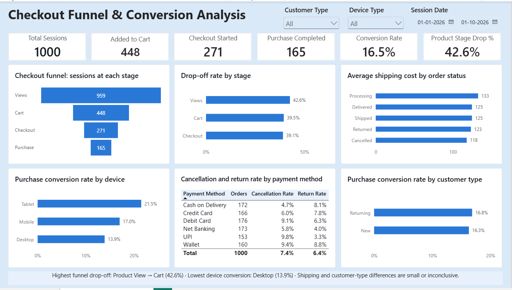

# data-analytics-projects
Data Analytics Projects using SQL, Python, Excel and Power BI

# E-commerce Checkout Experience & Conversion Analysis

## Project Overview

Analyzed sample e-commerce datasets to understand where users drop off during the purchase journey and examine how conversion and order outcomes vary by device type, customer type, payment method, and shipping cost.

**Business Question:** Where do customers drop off in the purchase journey, and which patterns should be investigated to improve conversion?

## Tools & Technologies

- **SQL:** Funnel analysis, conversion metrics, and order outcome analysis
- **Python (Pandas):** Data cleaning, preparation, and validation
- **Power BI (DAX):** KPI calculations and interactive dashboard development

## Dataset Overview

The project uses three sample datasets containing 1,000 rows each.

| Dataset | Description |
|---|---|
| `sessions` | Session date, device type, customer type, location, traffic channel, and campaign |
| `checkout_funnel` | Funnel stages reached per session, including product views, cart additions, checkout starts, completed purchases, and direct purchases |
| `pricing_orders` | Product category, price, quantity, discount, shipping cost, payment method, order status, and revenue |

The `sessions` and `checkout_funnel` tables are joined one-to-one using `session_id`. The `pricing_orders` dataset is analyzed separately, so order-level metrics are not expected to reconcile directly with session-level funnel metrics.

## Methodology

1. **Data Preparation:** Used Python and Pandas to clean, validate, and prepare the datasets.
2. **SQL Analysis:** Examined funnel performance, stage drop-off, conversion by device and customer type, payment cancellations and returns, and average shipping costs by order status.
3. **Dashboard Development:** Built a one-page interactive Power BI dashboard using DAX measures, KPI cards, charts, and slicers.

## Key Findings

### 1. Checkout Funnel Performance

| Funnel Stage | Sessions | Drop-off from Previous Stage |
|---|---:|---:|
| Website Visit | 1,000 | — |
| Product View | 959 | 4.1% |
| Add to Cart | 448 | 42.6%* |
| Checkout Started | 271 | 39.5% |
| Purchase Completed | 165 | 39.1% |

- **Overall purchase conversion rate:** 16.5%.
- The largest reported funnel loss was at the product-view stage, at 42.6% under the project's SQL definition.
- Cart-to-checkout and checkout-to-purchase drop-off were also substantial, at 39.5% and 39.1%, respectively.

### 2. Conversion by Device

| Device | Sessions | Conversion Rate |
|---|---:|---:|
| Tablet | 93 | 21.5% |
| Mobile | 605 | 17.0% |
| Desktop | 302 | 13.9% |

- Desktop had the lowest conversion rate.
- Desktop also showed a 49.2% drop between cart and checkout.
- Mobile showed a 40.8% drop between checkout and purchase.
- Tablet had the highest observed conversion rate, but its sample size was smaller.

### 3. Conversion by Customer Type

- New customers: **16.3%** conversion.
- Returning customers: **16.8%** conversion.

The difference was small, with no clear evidence of a meaningful conversion gap in this sample.

### 4. Payment Method Outcomes

- UPI had the highest observed cancellation rate at **9.8%**, followed by Wallet at **9.4%** and Debit Card at **9.1%**.
- Cash on Delivery had the lowest cancellation rate at **4.7%**, but a return rate of **8.1%**.
- Wallet had the highest observed return rate at **8.8%**.

These are observed associations in the sample and do not establish that a payment method causes cancellations or returns.

### 5. Shipping Cost Analysis

- Average shipping cost across the analyzed orders was approximately **125** in the dataset's currency units.
- Cancelled orders had the lowest average shipping cost, at approximately **118**.
- The analysis did not show a clear relationship between average shipping cost and order outcome.

## Power BI Dashboard

The interactive dashboard includes:

- KPI cards for sessions, cart additions, checkout starts, completed purchases, conversion rate, and product-stage drop-off.
- Checkout funnel and stage drop-off visualizations.
- Device-wise and customer-type conversion comparisons.
- Average shipping cost by order status.
- Payment method cancellation and return analysis.
- Slicers for customer type, device type, and session date.



## Recommendations

The analysis identifies areas worth investigating; it does not establish the causes of customer drop-off.

1. **Investigate the product-to-cart stage:** Test clearer pricing, discount, stock availability, and delivery information on product pages.
2. **Review checkout friction:** Examine whether reducing form fields and displaying the total payable amount earlier improves completion.
3. **Evaluate device-specific journeys:** Investigate the desktop cart-to-checkout journey and the mobile checkout experience separately.
4. **Improve delivery-cost transparency:** Test displaying shipping charges and estimated delivery information earlier.
5. **Monitor payment outcomes:** Track cancellation and return rates by payment method over time to determine whether the observed patterns persist.

## Limitations

- The datasets are sample data intended for portfolio and learning purposes.
- The analysis identifies where users drop off but cannot determine why, because detailed user behavior and cancellation reasons are unavailable.
- The reported 42.6% product-stage drop-off follows the project's SQL definition, which accounts for the `direct_purchase` flag. It should not be interpreted as a standard product-view-to-cart drop-off rate without that qualification.
- The `direct_purchase` flag appears in 102 sessions but does not lead to a completed purchase in this dataset. All 165 completed purchases follow the cart path.
- Device sample sizes differ, and Tablet has only 93 sessions. Observed differences should therefore be interpreted cautiously.
- Session-level funnel metrics and order-level payment and shipping metrics come from separate datasets and are not expected to reconcile directly.

## Repository Structure

```text
ecommerce-checkout-conversion-analysis/
├── data/              # Sample datasets used in the analysis
├── python/            # Pandas data preparation and validation
├── sql/               # SQL analysis queries
├── dashboard/         # Power BI (.pbix) file
├── dashboard.png      # Dashboard screenshot
└── README.md
```

## Disclaimer

This project uses sample data for portfolio and learning purposes. Findings describe patterns in the supplied dataset and should not be treated as verified business outcomes.
